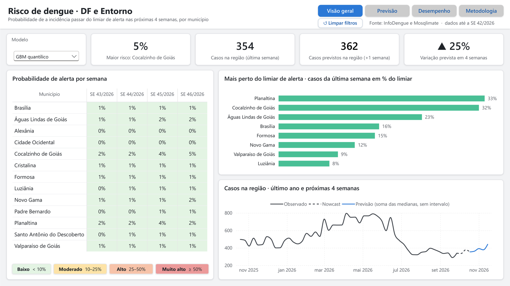
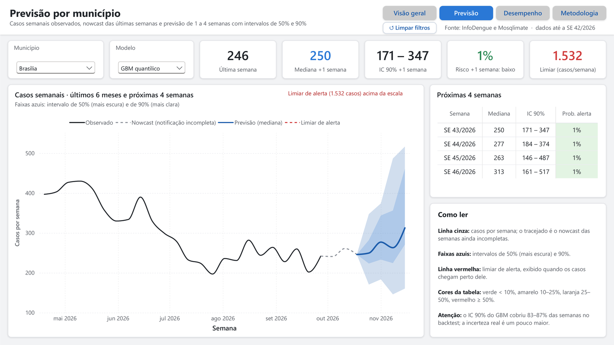
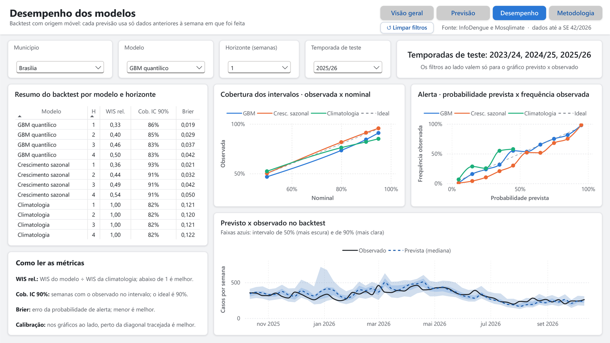

# Monitoramento de dengue: DF e Entorno

Previsão probabilística de casos de dengue de 1 a 4 semanas à frente para Brasília e os 12
municípios goianos da Periferia Metropolitana de Brasília, com a probabilidade de cada município
passar do limiar de alerta. O pipeline é em Python e os resultados aparecem em um painel no
Power BI (e numa versão em Streamlit).



- **Dados:** casos semanais e nowcasting do [InfoDengue](https://info.dengue.mat.br) e clima
  diário, os dois pela API do [Mosqlimate](https://api.mosqlimate.org); códigos de município pela
  API de localidades do IBGE.
- **Modelos:** dois baselines (climatologia e crescimento sazonal) e um gradient boosting
  quantílico global com defasagens de casos, sazonalidade e clima.
- **Avaliação:** backtest por origem móvel nas três últimas temporadas completas, com WIS
  (Weighted Interval Score), cobertura dos intervalos de 50, 80, 90 e 95% e Brier da probabilidade
  de alerta.
- **Painel:** visão geral do risco, previsão por município com faixas de incerteza, desempenho do
  backtest e metodologia.

## Resultados no backtest

Rodada de 3/11/2026, com 13 municípios e as temporadas 2023/24, 2024/25 e 2025/26 como teste. Em
cada semana do teste os modelos foram treinados só com o que se sabia até aquela semana.
O WIS relativo divide o WIS (em escala log) de cada modelo pelo da climatologia: abaixo de 1 é
melhor que a referência.

| Horizonte | WIS relativo: crescimento | WIS relativo: GBM | WIS (casos): crescimento | WIS (casos): GBM | Cobertura do IC 90%: GBM |
|---|---|---|---|---|---|
| 1 semana | 0,364 | **0,326** | 39,0 | **25,5** | 86,5% |
| 2 semanas | 0,443 | **0,402** | 57,4 | **38,6** | 84,8% |
| 3 semanas | 0,491 | **0,458** | 73,8 | **53,2** | 83,1% |
| 4 semanas | 0,535 | **0,505** | 93,0 | **70,0** | 82,9% |

O GBM ganhou nos quatro horizontes, e a vantagem cresce nas semanas de muitos casos (WIS em
casos). O crescimento sazonal, que parte do nível atual e aplica o crescimento típico daquela
época do ano, foi o baseline mais difícil de bater. O ponto fraco do GBM é a incerteza: o
intervalo de 90% cobriu entre 82,9% e 86,5% das semanas, enquanto o do crescimento sazonal ficou
perto do nominal (90,6% a 92,5%).

## O painel

| | |
|---|---|
|  |  |
| **Previsão por município:** série observada, nowcast das semanas ainda incompletas e previsão com intervalos de 50% e 90%, além da probabilidade de alerta semana a semana. | **Desempenho:** WIS relativo, cobertura e Brier por modelo e horizonte, curva de cobertura dos intervalos, diagrama de confiabilidade do alerta e previsto × observado no backtest. |

A quarta página resume dados, modelos, avaliação e a regra de alerta
([imagem](docs/img/painel_metodologia.png)).

O painel está em `powerbi/painel_dengue.pbip`, no formato de projeto do Power BI (modelo
semântico em TMDL e relatório em PBIR, tudo em texto). O modelo tem 11 tabelas, 71 medidas DAX e
um tema próprio. [docs/powerbi.md](docs/powerbi.md) explica como ele foi montado: tabelas,
relacionamentos, medidas e as decisões visuais de cada página.

## Como usar

### Instalação

Requer Python 3.10 ou mais recente.

```bash
git clone https://github.com/Hevenicio/monitoramento-dengue-df.git
cd monitoramento-dengue-df
python -m venv .venv
source .venv/bin/activate          # Windows: .venv\Scripts\activate
pip install -e ".[painel,dev]"
```

### Abrir o painel com os resultados já gerados

O repositório traz as tabelas da última rodada em `outputs/` (cerca de 5 MB), então dá para ver
o painel sem chave de API.

**Power BI Desktop:** abra `powerbi/painel_dengue.pbip` e clique em **Atualizar**. O parâmetro
`PastaDados` aponta para `C:\monitoramento-dengue-df\outputs\powerbi\`. Se você clonou o
repositório em outro lugar, ajuste o caminho em Transformar dados > Gerenciar parâmetros (ele
precisa terminar com a barra invertida).

**Streamlit:**

```bash
streamlit run app/painel.py
```

### Rodar com dados atualizados

1. Crie uma conta no [Mosqlimate](https://api.mosqlimate.org) e gere a chave de API no seu perfil.
2. Copie `.env.example` para `.env` e cole a chave em `MOSQLIMATE_API_KEY`. O `.env` não vai para
   o Git.
3. Confira os municípios em `config/settings.yaml` (os nomes sem código são resolvidos no IBGE).
4. Rode:

```bash
python -m dengue_df verificar          # teste rápido: chave, IBGE, InfoDengue e clima
python -m dengue_df ingerir -v         # série completa → data/processed/
python -m dengue_df executar -v        # backtest + previsão → outputs/ (imprime o resumo)
python -m dengue_df exportar-powerbi   # tabelas do painel → outputs/powerbi/
python -m dengue_df relatorio          # prévias em PNG (opcional)
```

Para atualizar toda semana sem intervenção, agende `scripts/atualizar_semanal.ps1` no Agendador
de Tarefas do Windows (detalhes em [docs/powerbi.md](docs/powerbi.md#6-atualização)).

### Demonstração com dados sintéticos

```bash
python -m dengue_df demo -v
```

Gera séries sintéticas no mesmo formato da API e roda o pipeline inteiro. Serve para testar a
instalação, mas grava por cima de `outputs/`; para voltar aos resultados reais, use
`git checkout -- outputs`. O painel em Streamlit mostra um aviso enquanto a fonte for sintética.

## Como funciona

| Modelo | Ideia | Papel |
|---|---|---|
| `climatologia` | Quantis históricos dos casos na mesma época do ano (± 3 semanas epidemiológicas) | Referência: ignora o nível atual |
| `crescimento` | Nível atual × distribuição empírica do crescimento em h semanas naquela época | Baseline forte de curto prazo |
| `gbm_quantilico` | `HistGradientBoostingRegressor` com perda quantílica, um modelo por horizonte e quantil; o alvo é o crescimento em log | Modelo principal |

- **Sem vazamento de informação:** as variáveis de uma origem t usam só semanas até t, e no
  backtest os modelos são treinados apenas com alvos anteriores ao início da temporada de teste
  (SE 41). Um teste altera o futuro e confere que as variáveis do passado não mudam.
- **Atraso de notificação:** nas últimas 3 semanas os casos ainda estão chegando, então o alvo
  passa a ser a estimativa de nowcasting do InfoDengue (`casos_est`), destacada nos gráficos.
- **Limiar de alerta:** percentil 90 da incidência semanal histórica de cada município. A
  probabilidade de alerta sai da distribuição prevista (quantis).
- **Temporada:** da SE 41 de um ano à SE 40 do seguinte.

### Como a ingestão lida com a API

- O download é feito por município e ano, e cada pedaço fica em cache em `data/raw/`. Se a
  ingestão cair no meio, rodar `ingerir` de novo retoma de onde parou.
- Pedaços que terminam nas últimas 12 semanas são baixados de novo a cada execução, porque o
  InfoDengue revisa essas semanas quando chegam notificações atrasadas. `--refazer` ignora o cache.
- Erros temporários ganham novas tentativas com espera crescente; chave inválida interrompe na
  primeira chamada. Se algum pedaço do InfoDengue falhar de vez, nada é gravado (a série de casos
  precisa estar completa). Falhas no clima viram aviso e os modelos seguem com o que houver.
- O clima costuma chegar alguns dias depois dos casos; `verificar` mostra esse atraso e `executar`
  avisa quando as últimas origens usam janelas climáticas incompletas.

## Estrutura do repositório

```
config/settings.yaml        território, período, alvo, horizontes, quantis, modelos
src/dengue_df/
  ingest/                   IBGE, InfoDengue, clima, download com cache e novas tentativas
  epiweek.py                semanas epidemiológicas e temporadas
  features.py               painel semanal, variáveis (passado) e alvos (futuro)
  models/                   climatologia, crescimento sazonal, GBM quantílico
  evaluation/               WIS, cobertura e backtest por origem móvel
  risk.py                   limiar de alerta e probabilidade de ultrapassá-lo
  pipeline.py               orquestração e gravação das tabelas em outputs/
  powerbi.py                exportação em modelo estrela para o Power BI
  painel_dados.py           dados do painel Streamlit
  report.py                 prévias estáticas em PNG
app/                        painel Streamlit + Plotly
powerbi/                    painel_dengue.pbip, consultas M, medidas DAX e tema
docs/                       guia do painel no Power BI e imagens
scripts/                    atualização semanal (PowerShell)
tests/                      testes (pytest), inclusive ingestão contra uma API simulada
outputs/                    tabelas da última rodada (Parquet)
```

## Testes

```bash
pytest -q
```

A ingestão é testada com um cliente falso que devolve as mesmas colunas da API. Se a API mudar o
nome de alguma coluna, a ingestão para com uma mensagem listando as colunas recebidas. Os testes
do Power BI conferem o modelo estrela exportado e se as medidas DAX só usam colunas e medidas que
existem.

## Limitações e próximos passos

- **Intervalos do GBM estreitos.** A cobertura do IC 90% ficou abaixo do nominal. Os caminhos
  são combinar os quantis do GBM com os do crescimento sazonal ou adicionar uma camada de
  conformal prediction por horizonte.
- **Total da região sem intervalo.** Quantis não se somam; a previsão da região é a soma das
  medianas, sem faixa de incerteza.
- **Mapa** da probabilidade de alerta com as malhas municipais do IBGE.
- **Demanda hospitalar:** converter casos previstos em internações esperadas.
- **Alertas automáticos** quando a probabilidade cruzar o limiar.

Este é um projeto pessoal, não um sistema oficial de vigilância. Para decisões de saúde
pública, a referência são os boletins das secretarias de saúde e o próprio InfoDengue.

## Dados e créditos

- Casos de dengue e nowcasting: [InfoDengue](https://info.dengue.mat.br).
- Acesso aos dados de casos e clima: [Mosqlimate](https://api.mosqlimate.org).
- Códigos e nomes de municípios: [API de localidades do IBGE](https://servicodados.ibge.gov.br/api/docs/localidades).

Os dados continuam sujeitos aos termos das fontes originais.

## Licença

Código sob a licença MIT. Veja [LICENSE](LICENSE).

## Autor

Hevenicio Silva · [github.com/Hevenicio](https://github.com/Hevenicio)
